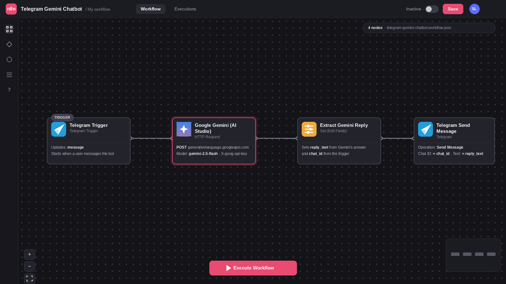

# Telegram Gemini Chatbot — an n8n workflow

A Telegram chatbot that actually talks back — built entirely in
[n8n](https://n8n.io/), powered by Google's Gemini AI. No code to write
and no script to keep running: you import one workflow file into n8n,
add two keys, switch it on, and your bot starts answering.

Someone messages your bot on Telegram → n8n sends the message to Gemini
(through the free Google AI Studio API) → Gemini's answer comes back →
the bot replies in the same chat.



## The workflow, node by node

The file [`telegram-gemini-chatbot.workflow.json`](telegram-gemini-chatbot.workflow.json)
contains four nodes, already connected in order:

| # | Node | What it does |
| - | ---- | ------------ |
| 1 | **Telegram Trigger** | Wakes the workflow whenever someone sends your bot a message |
| 2 | **Google Gemini (AI Studio)** | An HTTP Request node that sends the message text to the Gemini API (`gemini-2.5-flash`) and gets the reply |
| 3 | **Extract Gemini Reply** | Pulls the reply text and the chat ID out of Gemini's response, so the answer goes back to the right chat |
| 4 | **Telegram Send Message** | Sends the reply to the user in the same Telegram chat |

## What you need

- An n8n instance — your own, or an [n8n Cloud](https://n8n.io/cloud/) account
- A Telegram account (to create the bot with BotFather)
- A free Gemini API key from Google AI Studio
- About 10 minutes

No payment needed. The Gemini free tier is plenty for personal use and
testing.

## Setup, step by step

### 1. Create the Telegram bot

Open Telegram, talk to [@BotFather](https://t.me/BotFather) (the one with
the blue verified tick), send `/newbot`, and answer the two questions —
a display name, then a username ending in `bot`. BotFather replies with a
**token**: a long string that is your bot's password. Keep it safe; you
will paste it into n8n in step 4.

### 2. Get your free Gemini API key

1. Go to [Google AI Studio](https://aistudio.google.com/) and sign in with
   a Google account.
2. Open [aistudio.google.com/apikey](https://aistudio.google.com/apikey)
   (or click **Get API key** in the left menu).
3. Click **Create API key**. If it asks, create or pick a Google Cloud
   project — the default choice is fine.
4. Copy the key it shows you. It starts with `AIza`.

The key is free and you do not need to add a card.

### 3. Import the workflow into n8n

1. Download `telegram-gemini-chatbot.workflow.json` from this repo.
2. Open your n8n, click the **…** menu at the top right, and choose
   **Import from File** (in some versions it is under
   **Workflows → Import from File**).
3. Pick the JSON file. The workflow opens on the canvas with all four
   nodes connected. It imports **inactive** — nothing runs until you add
   the two credentials and switch it on.

The imported file contains placeholders for both credentials, on purpose —
your real keys should never live inside a shared file.

### 4. Add the Telegram credential

1. In n8n, open **Credentials → New** and search for **Telegram API**.
2. Paste your BotFather token into the **Access Token** field.
3. Save it, with a name like `Telegram account`.
4. Back in the workflow, click the **Telegram Trigger** node and select
   this credential. Do the same on the **Telegram Send Message** node —
   both Telegram nodes must use the same credential.

### 5. Add the Gemini credential

The Gemini node calls the API directly, so the key goes in as a header
credential:

1. In n8n, open **Credentials → New** and search for **Header Auth**.
2. Set **Name** to exactly `X-goog-api-key`.
3. Set **Value** to your Gemini API key from step 2.
4. Save it, with a name like `Google Gemini API Key`.
5. Back in the workflow, click the **Google Gemini (AI Studio)** node and,
   under **Credential for Header Auth**, select this credential.

### 6. Activate and test

1. Click the **Active** toggle at the top right of the workflow so it
   turns on.
2. Open Telegram, find your bot, press **Start**, and send it any
   message — a question, "explain photosynthesis like I'm 12", anything.
3. The bot should reply with Gemini's answer within a few seconds.
4. To see what happened under the hood, open the workflow's
   **Executions** tab in n8n — every message shows up there, node by
   node, so you can see exactly what Gemini returned.

To stop the bot, switch **Active** off again. Telegram keeps the
messages; the bot just stops answering them.

## An honest note: v1 has no memory

This version is **stateless** — each message is answered on its own.
Ask "why does that happen?" right after another question and the bot
will not know what "that" was, because nothing about the earlier
messages is sent along. For one-shot questions, explanations and drafts
it works fine. Conversation memory (keeping the last few messages per
chat, for example in an n8n Data Table, and sending them with each
request) is the natural next step.

Also in v1: text messages only — photos, voice notes and stickers are
ignored — and a very long Gemini answer can hit Telegram's
4096-character message limit.

## A short demo

```
You:  Explain photosynthesis like I'm 12.
Bot:  Think of a leaf as a tiny kitchen. Sunlight is the stove,
      water and air are the ingredients, and the plant cooks up
      sugar for food. The leftover smell from the kitchen is
      oxygen — which is what we breathe.

You:  Draft a short leave application for tomorrow.
Bot:  Subject: Leave application for tomorrow
      Respected Sir/Madam, I request leave for tomorrow due to
      a personal commitment. I will finish my pending work
      before I leave today. Thank you.
```

## Make it yours

- **Change the model:** edit the URL in the **Google Gemini (AI Studio)**
  node — the model name sits in the middle of it
  (`gemini-2.5-flash`). Any current Gemini model works there.
- **Change the tone:** the same node builds the request; you can wrap
  the user's text with an instruction, for example
  "Answer like a patient maths tutor: " in front of the message, and
  every reply follows it.
- **Change the temperature:** `generationConfig` in the same node —
  lower is more factual, higher is more creative.

## Small troubles

- **Workflow is on but the bot never replies** — check the Telegram
  credential is selected on *both* Telegram nodes, and that you pressed
  **Start** in the chat with the bot the token belongs to.
- **401 / API key error on the Gemini node** — the Header Auth credential
  name must be exactly `X-goog-api-key`, and the value must be the AI
  Studio key, not the BotFather token. The two keys are easy to swap by
  mistake.
- **429 / quota error** — the Gemini free tier's daily limit is reached.
  It resets the next day.
- **Nothing in Executions** — the workflow is not Active, or the trigger
  webhook did not register. Switch it off and on once; n8n re-registers
  the Telegram webhook when the workflow activates.

## Project structure

```
telegram-gemini-chatbot/
├── telegram-gemini-chatbot.workflow.json   # The n8n workflow — import this
├── n8n-workflow-preview.png                # How the flow looks on the canvas
├── README.md                               # This guide
└── LICENSE                                 # MIT
```

## License

MIT — see [LICENSE](LICENSE). Use it, change it, build on it.

## Author

**Shubhranil Layek** — developer, Durgapur, India.
Portfolio: [shubhranillayek.github.io](https://shubhranillayek.github.io/)
· GitHub: [github.com/shubhranillayek](https://github.com/shubhranillayek)

I also build Telegram bots to order — FAQ and support bots, alert bots,
and AI chatbots like this one. If you need a bot for your business, the
portfolio above has my contact details.
